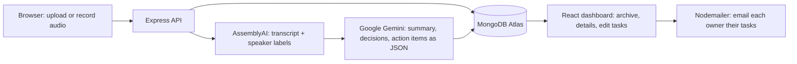

# MeetingNotes AI: Meeting Notes and Action-Item Generator

Upload a meeting recording, or record one in your browser, and get a **speaker-labeled transcript, a summary, decisions, and action items with owners and deadlines**. Send the action items to each person by email, and search your whole meeting archive later.


 **Note:** the backend runs on a free hosting plan that goes to sleep when idle. If the first page load or login takes about a minute, wait and try again. After that it responds normally.


## The problem

Teams forget what was decided in meetings and who promised to do what. This app turns a raw recording into structured, searchable, actionable notes, so decisions and tasks are not lost.

## Features

- **Audio upload** (MP3, WAV, M4A, MP4, WEBM, OGG, AAC, FLAC, up to 100 MB) with drag and drop and a progress bar
- **In-browser recording** with timer, playback preview and microphone permission handling
- **Speech-to-text transcript with speaker labels** (speaker diarization), with timestamps
- **AI summary, decisions and action items**, each action item with an owner and a deadline
- Relative deadlines such as "next Friday" are converted to real dates using the meeting date
- **Rename speakers**, and task owners update to match
- **Edit action items**: task, owner, owner email, deadline, done, add and delete
- **Send action items by email**: one email per person, listing their open tasks, with a confirmation step
- **Searchable meeting archive** with partial-word search, text snippets, status filter and pages
- **Live status** (Queued, Transcribing, Analyzing, Ready, Failed) that updates by itself, plus a **Retry** button for failed meetings
- Accounts with secure login (JWT). Every user only sees their own data

## How it works



1. The upload endpoint saves the file and creates a meeting with status `uploaded`, then replies immediately.
2. A background pipeline sets the status to `transcribing`, sends the audio to AssemblyAI, and saves the transcript. The audio file is then deleted.
3. The status becomes `analyzing`. The transcript and the meeting date go to the LLM, which must return JSON with `summary`, `decisions` and `actionItems`. The result is validated before saving.
4. The status becomes `done`, or `failed` with a readable error message. A failed meeting can be retried and resumes from where it stopped.
5. The frontend checks the status every 5 seconds while a meeting is processing.

### Handling AI mistakes

- The prompt tells the model to use only information in the transcript and to return `null` when unsure, so owners and deadlines are not invented.
- Each action item includes a quote from the transcript as evidence.
- The server validates the model output (shape, dates) and retries once on bad output.
- Every field can be edited by the user.

## Tech stack

| Layer | Technology |
|---|---|
| Frontend | React (Vite), React Router, Tailwind CSS, Axios |
| Backend | Node.js, Express, Multer (uploads), JWT and bcryptjs (auth), Nodemailer (email) |
| Database | MongoDB Atlas with Mongoose |
| Speech-to-text | AssemblyAI (with speaker labels) |
| LLM | Google Gemini API |
| Hosting | Vercel (frontend), Render (backend), MongoDB Atlas |

## Project structure

```
meeting-notes-ai/
├── client/                  React app
│   └── src/
│       ├── api.js           Axios setup (adds the login token)
│       ├── context/         AuthContext
│       ├── hooks/           useRecorder, useDebounce
│       ├── components/      Navbar, StatusBadge, TranscriptView, ActionItemsPanel, SendEmailSection ...
│       └── pages/           Login, Register, Dashboard, Upload, MeetingDetail
└── server/                  Express API
    ├── src/
    │   ├── config/          database connection
    │   ├── middleware/      auth, upload, validation, error handling
    │   ├── models/          User, Meeting, ActionItem
    │   ├── routes/          auth, meetings, actionItems
    │   ├── services/        transcriber, analyzer, pipeline, emailer
    │   └── utils/           validators
    └── scripts/             test scripts (transcribe, analyze, email)
```

## Getting started (run locally)

### Requirements
- Node.js 18 or newer
- A MongoDB Atlas database (the free tier is enough)
- API keys for **AssemblyAI** and **Google Gemini**
- A **Mailtrap** account (free sandbox inbox) to test email safely

### 1. Clone and install

```bash
git clone https://github.com/docnawal2023-hue/meeting-notes-ai.git
cd meeting-notes-ai

cd server && npm install
cd ../client && npm install
```

### 2. Configure environment variables

Copy each example file and fill in your own values.

**`server/.env`** (see `server/.env.example`)

| Variable | Description |
|---|---|
| `PORT` | API port, for example `5000` |
| `MONGO_URI` | MongoDB connection string. Include a database name, for example `.../meetingnotes?retryWrites=true&w=majority` |
| `JWT_SECRET` | A long random string |
| `ASSEMBLYAI_API_KEY` | AssemblyAI API key |
| `GEMINI_API_KEY` | Google Gemini API key |
| `GEMINI_MODEL` | Gemini model name, for example a current Flash model |
| `CLIENT_URL` | Frontend address allowed by CORS, for example `http://localhost:5173` |
| `SMTP_HOST`, `SMTP_PORT`, `SMTP_USER`, `SMTP_PASS` | SMTP details (Mailtrap sandbox for testing) |
| `MAIL_FROM` | Sender shown in emails |
| `BREVO_API_KEY`, `BREVO_SENDER_EMAIL` | *Optional.* Send email over HTTPS instead of SMTP (for hosts that block SMTP ports) |

**`client/.env`** (see `client/.env.example`)

| Variable | Description |
|---|---|
| `VITE_API_URL` | API address, for example `http://localhost:5000/api` |

> Never commit `.env` files. They are listed in `.gitignore`.

### 3. Run

In two terminals:

```bash
# Terminal 1: API
cd server
npm run dev

# Terminal 2: frontend
cd client
npm run dev
```

Open **http://localhost:5173**, register an account, and upload or record a short meeting.

## API overview

All routes except `/api/auth/register`, `/api/auth/login` and `/api/health` require the header `Authorization: Bearer <token>`.

| Method and path | Purpose |
|---|---|
| `POST /api/auth/register` | Create an account |
| `POST /api/auth/login` | Log in and receive a token |
| `GET /api/auth/me` | Current user |
| `POST /api/meetings/upload` | Upload audio (form-data: `audio`, `title`, `date`) and start processing |
| `GET /api/meetings?search=&status=&page=&limit=` | List and search my meetings |
| `GET /api/meetings/:id` | One meeting with transcript and action items |
| `PATCH /api/meetings/:id` | Edit title, date, summary, decisions |
| `DELETE /api/meetings/:id` | Delete a meeting and its action items |
| `PATCH /api/meetings/:id/speakers` | Rename speakers |
| `POST /api/meetings/:id/retry` | Retry a failed meeting |
| `GET` / `POST /api/meetings/:id/action-items` | List or add action items |
| `PATCH` / `DELETE /api/action-items/:id` | Edit or delete an action item |
| `GET /api/action-items?status=open` | All my tasks across meetings |
| `POST /api/meetings/:id/send-emails` | Email each owner their open tasks |
| `GET /api/health` | Health check |

## Security

- Passwords are hashed with bcrypt and never returned by the API
- JWT authentication on all data routes, and every query is filtered by the logged-in user
- Upload file type and size checks on both client and server
- Only allowed fields can be updated (no passing request bodies straight into the database)
- Email content is HTML-escaped, because task text comes from an AI model
- API keys live in environment variables, not in the repository

## Screenshots

| Dashboard | Meeting details |

 | 
 |

| Record and upload | Email sent |
|---|---|
|
 | 
 |


## Author

**NAWAL FATIMA**, : *AI Meeting Notes and Action-Item Generator*.
